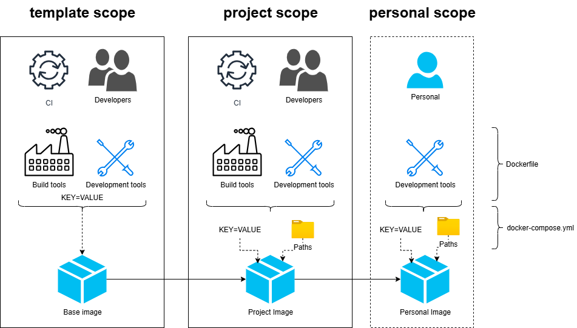
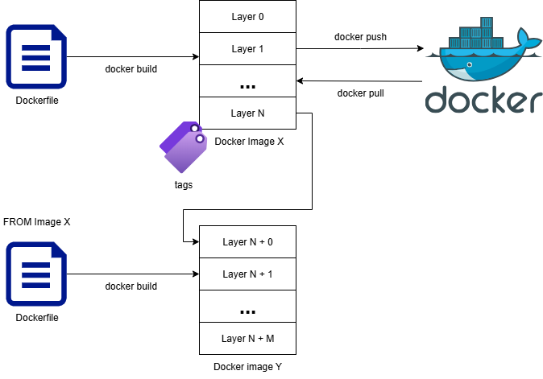

# Build tools

Each project needs dedicated tools to compile and/or develop.

Depending on the goals, the toolset might vary. A CI might only need required tools to build while a developper might need additional ones to debug. Some tools might be required to compile a specific project while some others are just a personal preference.

This guide explains you how to combine both in the most convenient way possible.

## Scopes



We identify the following 3 scopes :
1. Framework/template scope
2. Project scope
3. Personal scope

### Template scope

This scope encompass everything needed or required by every projects of the Aquila ecosystem.

It includes
- Toolchains for each platform
- Common development tools (e.g. Python, CMake, ...)
- Associated environment variables (e.g PATH)

### Project scope

In the context of your project, you might need specific tools, environment variables or paths to be present in the container. They are required to build but not general purpose.

It includes
- Specific SDKs (e.g. Axelera)
- Specific technology (e.g. Qt)
- Special environment variables

### Personal scope

When developping, you might want specific tools or inject customized logic or behaviour that is specific to your own personal environment. Or just a personal convenience.

This includes
- Custom environment variable (e.g. VCPKG_MAX_CONCURRENCY) to cope with your machine
- Tools that are convenient for you to develop or debug (e.g. iproute2, ncdu, ...)
- Personal paths or environment variables (e.g. VCPKG_ROOT=/my/cool/folder)

# Technologies

## Docker extension

[Docker](https://www.docker.com/) is a very convenient technology when it comes to providing a consistent and reproducible build environment.

Moreover, due to its layered approach, Docker images can be easily extended



## Docker compose

[Docker compose](https://docs.docker.com/compose/) is a tool that allows you to customize the way a Docker image is launched.

It allows you, amongst other things, to easily inject paths and environment variables through a declarative file

### Example

```yaml
services:
  dev:
    volumes:
      - /extra/path/on/host:/extra/path/in/container
    environment:
      - CMAKE_BUILD_PARALLEL_LEVEL=8
```

## env_launch.py

This script is mainly used to perform 2 tasks
- Ensure the target Docker image is available locally (either by building it or pulling it)
- Inject local environment variables and paths to make you feel at home inside the container

### Extending images

Thanks to his **--extensions** parameter it can take multiple Dockerfile and chain them to build a cumulative image (which Docker does not natively offer) provided the chained Dockerfile are properly starting with

```Dockerfile
ARG BASE_IMAGE
FROM ${BASE_IMAGE}

# Do whatever you like to extend BASE_IMAGE
```

through

```bash
$> docker build --build-arg BASE_IMAGE=<previous image> -t next_image .
```

## Devcontainer

[Dev container](https://code.visualstudio.com/docs/devcontainers/containers) is an extension from Visual Studio Code that allows you to natively integrate container orchestration inside your IDE.

It uses a devcontainer.json inside a .devcontainer folder and is mainly used to automate what env_launch.py does directly from your IDE.

### Example

```json
{
  "name": "My Python dev environment",
  "image": "python:3.11-slim",
  // Install Git and required tools
  "postCreateCommand": "apt-get update && apt-get install -y git && pip install --user -r requirements.txt",
  // Add specific extensions for Python
  "customizations": {
    "vscode": {
      "extensions": [
        "ms-python.python",
        "ms-python.vscode-pylance"
      ]
    }
  }
}
```

## In practice

Here is the proposed layout for project templates

```
project/
├── .devcontainer/
│   ├── devcontainer.json
│   ├── docker-compose.dev.yml    # Git ignored
│   ├── docker-compose.yml
│   └── initialize.py
├── dockers/
│   ├── Dockerfile.aquila
│   └── Dockerfile.dev.aquila     # Git ignored
├── .gitignore
└── environment/                  # Git submodule (external)
    ├── dockers/
    │   ├── Dockerfile.aquila
    │   └── Dockerfile.devcontainer
    └── env_launch.py
```

### devcontainer.json

```json
{
  "name": "Project name",
  "initializeCommand": [
    "${localWorkspaceFolder}/.devcontainer/initialize.py",
    "-n", "aquila",
    "--network",
    "--extensions", "${localWorkspaceFolder}/dockers/Dockerfile.aquila,${localWorkspaceFolder}/dockers/Dockerfile.dev.aquila",
    "--devcontainer", "${localWorkspaceFolder}/out/devcontainer.yml",
    "-c", "true"
  ],
  "dockerComposeFile": [
    "docker-compose.yml",
    "docker-compose.dev.yml",
    "${localWorkspaceFolder}/out/devcontainer.yml"
  ],
  "service": "dev",
  "shutdownAction": "stopCompose",
  "workspaceFolder": "${localWorkspaceFolder}",
  "customizations": {
    "vscode": {
        // Place here only extensions that are required for everyone using this devcontainer.
        // For personal preferences, add them in your own personal settings
        // (CTRL+Shift+P -> Preferences: Open User Settings (JSON)) through
        // 'dev.containers.defaultExtensions' setting.
        "extensions": [
            "github.copilot",
            "github.copilot-chat",
            "ms-python.debugpy",
            "ms-python.python",
            "ms-python.vscode-pylance",
            "ms-vscode.cmake-tools",
            "ms-vscode.cpptools",
            "ms-vscode.cpptools-extension-pack",
            "ms-vscode.cpptools-themes"
        ],
        // Place here only settings that are required for everyone using this devcontainer.
        // For personal preferences, add them in your own personal settings
        // (CTRL+Shift+P -> Preferences: Open User Settings (JSON))
        "settings": {
        }
    },
    // Features are mainly a way to modify/augment the devcontainer environment.
    // There is already the dockers/Dockerfile.dev.X for that specific purpose
    // that you can modify as needed. Just pay attention that this specific
    // layer is for you only and won't be used by any CI. So if your build relies
    // on specific features you added there they are probably misplaced and belong
    // to dockers/Dockerfile.X
    "features": {
    }
  } 
}
```

### docker-compose.yml

It allows the project to specify the path and environment variable needed by everyone for this projec (see project scope)

```yaml
services:
  dev:
    privileged: true
    network_mode: host
    stdin_open: true
    tty: true
    volumes:
      - ${HOME}:${HOME}:cached
      - ${SSH_AUTH_SOCK:-/dev/null}:/ssh-agent:ro
    environment:
      - VCPKG_ROOT=${VCPKG_ROOT}
      # Empty value means "full core count"
      - CMAKE_BUILD_PARALLEL_LEVEL=
      - SSH_AUTH_SOCK=${SSH_AUTH_SOCK:+/ssh-agent}
```

**Warning**

Any specific path or environment variable added here might not be automatically picked up by the CI. For any CI related topic, refer to [evs-hwfw-teamcity](https://bitbucket.evs.tv/projects/VSE/repos/evs-hwfw-teamcity/browse).

### docker-compose.dev.yml

This file serves the same purpose as docker-compose.yml but for your personal settings (see personal scope). It should not be persisted with the project (i.e. it should be Git ignored).

```yaml
services:
  dev:
    # Extra/overridden bind mounts (see docker-compose.yml for reference)
    volumes: []
    # Extra/overridden environment vars (see docker-compose.yml for reference)
    environment: []
```

### initialization.py

This script is just a wrapper around env_launch.py that does the following
1. It creates the files that are git ignored if they do not exist locally (e.g. .devcontainer/docker-compose.dev.yml or dockers/Dockerfile.dev.aquila)
2. It deffer image creation to env_launch through **--extensions** and **--devcontainer** parameter that
    - Build the proper Docker image
    - Creates the required docker-compose with the name of the image to launch (i.e. ${localWorkspaceFolder}/out/devcontainer.yml)
    - Adds a Docker image layer extension to automatically register the local user inside the container (see evs-hwfw-environment/dockers/Dockerfile.devcontainer below)

### dockers/Dockerfile.X

This file allows you to extend base Docker image with tools needed for your specific project (see project scope)

```Dockerfile
ARG BASE_IMAGE
FROM ${BASE_IMAGE} AS image_devel

# Add what you need for your project here
```

### dockers/Dockerfile.dev.X

This file serves the same purpose as dockers/Dockerfile.X but for your personal settings (see personal scope). It should not be persisted with the project (i.e. it should be Git ignored).

```Dockerfile
ARG BASE_IMAGE
FROM ${BASE_IMAGE} AS image_devel

# Add your custom things here namely to debug things or customize your environment
# Pay attention that any modification made here will be yours only. No CI or others
# developper will never see them. So if your build rely on some feature placed here
# they are misplaced and should belong to the non .dev. Dockerfile.
```

### .gitignore

In order to exclude *.dev.* file mentionned above include the following lines to your .gitignore

```gitignore
# Dev specific
.devcontainer/docker-compose.dev.yml
dockers/Dockerfile.dev.*
```

### evs-hwfw-environment/dockers/Dockerfile.Aquila

It's the base image that will be used by all C++ projects of the Aquila ecosystem. It should be kept minimal.

### evs-hwfw-environment/dockers/Dockerfile.devcontainer

It's just an additional layer to

1. Map the local user inside the container
2. Give the user passwordless sudo privilege inside the container

The following is possible inside the container

```bash
$> sudo apt-get update && sudo apt-get install -y htop
```

```Dockerfile
ARG BASE_IMAGE
FROM ${BASE_IMAGE} AS image_devel

ARG USERNAME
ARG USER_UID
ARG USER_GID

USER root

RUN apt-get update && apt-get install -y --no-install-recommends \
      sudo \
    && apt-get clean \
    && rm -rf /var/lib/apt/lists/*

# Make sure our user exists and can do sudo without password in the container
RUN groupadd --gid $USER_GID "$USERNAME" \
    && useradd --uid $USER_UID --gid $USER_GID -m -d "/home/$USERNAME" -s /bin/bash "$USERNAME" \
    && echo "$USERNAME ALL=(root) NOPASSWD:ALL" > /etc/sudoers.d/$USERNAME \
    && chmod 0440 /etc/sudoers.d/$USERNAME

# Switch to our user by default
USER "$USERNAME"
```
